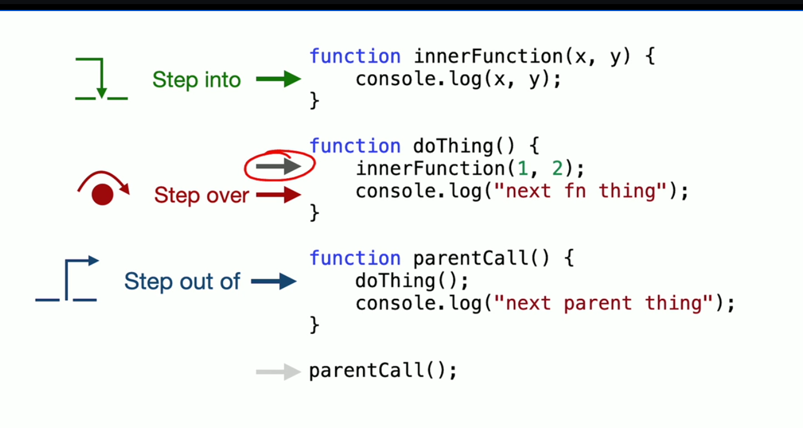

# JavaScript

HTML gives a page its structure and CSS gives it style. **JavaScript gives it behaviour.** This
folder goes from the very basics (variables) up to changing a web page with the DOM.

Every `.js` file starts with a **comment header** explaining the topic, is split into numbered
sections, and has inline comments showing the expected output (`// 10`). Look for:

- **TRY IT**: a small experiment to run
- **⚠️**: a common mistake, left in the code (commented out) so you can study it

The `.md` files are longer notes that go deeper into the theory and end with
*Check your understanding* questions.

---

## How to run the code

You only need a browser. [Node.js](https://nodejs.org/) is optional.

**Option A: the browser**
1. Open a folder's `index.html` (double-click it, or use the VS Code **Live Server** extension).
2. Open DevTools with `F12` (or right-click → *Inspect*) and go to the **Console** tab.
3. Edit the `.js` file, save it, and refresh the page.

**Option B: Node.js**
```bash
cd JavaScript/functions
node function.js
```
Everything except `JS_and_DOM/dom_basics.js` runs in Node, because `document` only exists in the browser.

**Option C: just experiment.** Type any snippet straight into the browser console and press Enter.

---

## Learning path

Follow the folders in this order. Each one only uses ideas from the folders before it.

| # | Folder | Topics | Start with |
|---|--------|--------|------------|
| 1 | [basics/](basics/) | `var` / `let` / `const`, scope, hoisting, the TDZ | [var_n_let_n_const.md](basics/var_n_let_n_const.md) |
| 2 | [if_else/](if_else/) | `if` / `else if` / `else`, `&&` `\|\|` `!`, truthy and falsy values | [if_else.js](if_else/if_else.js) |
| 3 | [seq_n_iterations/](seq_n_iterations/) | Arrays, `while`, `for`, `for...of`, `break` / `continue`, spread and destructuring | [seq_n_iteration.js](seq_n_iterations/seq_n_iteration.js) |
| 4 | [functions/](functions/) | Defining and calling functions, IIFEs, rest parameters, callbacks, higher-order functions, closures | [function.js](functions/function.js) |
| 5 | [JS_and_DOM/](JS_and_DOM/) | Objects, object spread, `window` and `document`, `querySelector` / `querySelectorAll`, `classList`, click events | [objects.js](JS_and_DOM/objects.js) |
| 6 | [nullish_coalescing/](nullish_coalescing/) | `??`, `?.`, `??=`, default parameters | [nullish_coalescing.js](nullish_coalescing/nullish_coalescing.js) |
| 7 | [call_stacks/](call_stacks/) | The call stack, reading stack traces, `console.trace()`, the `debugger` statement and DevTools | [call_stacks.js](call_stacks/call_stacks.js) |

Each folder has its own `README.md` with the file list, key ideas and practice exercises.

---

## Quick reference cheat sheet

### Declaring variables
```js
const PI = 3.14;      // default choice: can't be reassigned
let count = 0;        // use when the value will change
count += 1;
// var x = 1;         // old style: avoid (function-scoped, hoisted as undefined)
```

### Conditionals
```js
if (score > 90) { ... } else if (score > 80) { ... } else { ... }
const label = isAdmin ? 'Admin' : 'User';   // ternary: a one-line if/else
```
Falsy values: `false` `0` `-0` `0n` `""` `null` `undefined` `NaN`. **Everything else is truthy.**

### Loops
```js
for (let i = 0; i < arr.length; i++) { ... }   // when you need the index
for (const item of arr) { ... }                // when you just need each item
while (condition) { ... }                      // when you don't know how many times
```

### Functions
```js
function add(a, b) { return a + b; }           // declaration (hoisted)
const add2 = function (a, b) { return a + b; } // expression
const add3 = (a, b) => a + b;                  // arrow function (implicit return)
```

### Objects
```js
const user = { name: 'Sam', age: 20 };
user.name;          // read  -> 'Sam'
user.city = 'Pune'; // add
delete user.age;    // remove
```

### Spread, rest and destructuring (`...`)
```js
const all  = [...arr1, ...arr2];          // spread: join arrays into a new one
const copy = [...arr];                    // shallow copy of an array
const updated = { ...user, theme: 'light' }; // copy an object and override a property
Math.max(...nums);                        // spread an array into separate arguments
function sum(...nums) { }                 // rest: gather arguments into an array
const [first, ...rest] = arr;             // destructuring with a rest element
```

### The DOM and events
```js
const btn   = document.querySelector('#save');      // first match, or null
const items = document.querySelectorAll('li');      // NodeList of all matches
btn.textContent = 'Saved!';                         // change the text
btn.classList.add('active');                        // add / remove / toggle classes
btn.setAttribute('disabled', '');                   // set any attribute
btn.addEventListener('click', handleClick);         // run handleClick on every click
```

### Safe access and defaults
```js
const city  = user?.address?.city ?? 'Unknown';  // no crash if address is missing
const count = input ?? 0;                        // keeps 0 and "", unlike ||
```

### Comparing values
Use `===` and `!==` (strict). Avoid `==`: it converts types first, so `"0" == false` is `true`.

---

## Debugging with the call stack and the debugger

### The call stack
The **call stack** is the engine's list of functions that are currently running. When a function
is called it is pushed onto the stack; when it returns it is popped off. The last function added
is always the first one removed.

When an error is thrown, the console prints the stack at that moment (a **stack trace**). Read it
top to bottom: the top line is where it broke, and each line below is the function that called it.

```
Uncaught ReferenceError: doesNotExist is not defined
    at multiply (call_stacks.js:42:17)     <- broke here
    at square (call_stacks.js:47:12)       <- called by square
    at printSquare (call_stacks.js:51:21)  <- called by printSquare
    at call_stacks.js:55:1                 <- called from the top level of the file
```

`console.trace('label')` prints a message **plus** the current call stack, without throwing an error.

### Pausing code with the debugger
Instead of scattering `console.log`s, you can **pause** the code and inspect it line by line.

1. Open the page and DevTools (`F12`), then go to the **Sources** tab (Chrome) or **Debugger** tab (Firefox).
2. Pause the code in either of two ways:
   - Click a **line number** in the file to set a **breakpoint**, then refresh the page.
   - Write the `debugger;` statement in your code. It pauses execution there **only while DevTools is open**
     (otherwise it is ignored). Remove it before you ship the code.
3. While paused, you can:
   - hover over a variable to see its current value,
   - look at the **Scope** panel for every local and global variable,
   - look at the **Call Stack** panel to see which functions led to this line,
   - type expressions into the Console, which runs them in the paused scope.

```js
function square(n) {
  debugger;              // execution pauses here while DevTools is open
  return multiply(n, n);
}
```

### Stepping through code
Once paused, the step buttons move execution forward in different ways:



Suppose execution is paused on `innerFunction(1, 2);` inside `doThing()` (the circled arrow):

| Button | Shortcut (Chrome) | What it does | Next line it stops on |
|--------|-------------------|--------------|-----------------------|
| **Resume** | `F8` | Keep running until the next breakpoint (or the end) | the next breakpoint |
| **Step over** | `F10` | Run the whole function call on this line without going inside it | `console.log("next fn thing")` in `doThing` |
| **Step into** | `F11` | Go *inside* the function being called on this line | `console.log(x, y)` in `innerFunction` |
| **Step out of** | `Shift + F11` | Finish the current function and return to whoever called it | `console.log("next parent thing")` in `parentCall` |

Use **step into** when you suspect the bug is inside the called function, **step over** when you trust
it, and **step out** when you've seen enough of the current function. Watch the **Call Stack** panel
as you step: it grows when you step into a function and shrinks when you step out.

---

## Common mistakes covered in this folder

| Mistake | Where |
|---------|-------|
| Forgetting to update the counter, or using `continue` before the update, so the loop never ends | [seq_n_iterations/](seq_n_iterations/) |
| Counting down with `i++` instead of `i--` | [seq_n_iterations/](seq_n_iterations/) |
| Assigning to a variable you never declared, which creates an accidental global | [seq_n_iterations/](seq_n_iterations/), [var_n_let_n_const.md](basics/var_n_let_n_const.md) |
| Using `myFunc()` (calling it) when you meant `myFunc` (passing the function) | [firstClass_n_higherOrder_functions.md](functions/firstClass_n_higherOrder_functions.md) |
| Checking a broad condition before a specific one in an `if` chain | [if_else.js](if_else/if_else.js) |
| Using `\|\|` for defaults, which wipes out valid `0` or `""` values | [truthy_falsy.md](if_else/truthy_falsy.md) |
| Writing `user?.address.city`, which still crashes when `address` is missing | [nullish_coalescing.js](nullish_coalescing/nullish_coalescing.js) |
| Running DOM code in `<head>` before the elements exist | [JS_and_DOM/](JS_and_DOM/) |
| Writing `addEventListener('click', fn())`, which calls `fn` once instead of on every click | [click_events.js](JS_and_DOM/click_events.js) |
| Using a property on the `null` that `querySelector` returns when nothing matches | [dom_basics.js](JS_and_DOM/dom_basics.js) |
| Writing `const copy = arr` (that's the same array, not a copy) | [seq_n_iteration.js](seq_n_iterations/seq_n_iteration.js) |
| Expecting `{...obj}` to copy nested objects too (it's a shallow copy) | [objects.js](JS_and_DOM/objects.js) |
| Storing `'false'` (a string, which is truthy) instead of `false` | [objects.js](JS_and_DOM/objects.js) |
| Leaving a `debugger;` statement in finished code | [call_stacks.js](call_stacks/call_stacks.js) |

---

## Useful resources

- [MDN JavaScript Guide](https://developer.mozilla.org/en-US/docs/Web/JavaScript/Guide): the official reference
- [javascript.info](https://javascript.info/): a free, beginner-friendly tutorial from start to finish
- [MDN: Introduction to the DOM](https://developer.mozilla.org/en-US/docs/Web/API/Document_Object_Model/Introduction)
- [Chrome DevTools: Debug JavaScript](https://developer.chrome.com/docs/devtools/javascript)

---

[← Back to the main README](../README.md)
